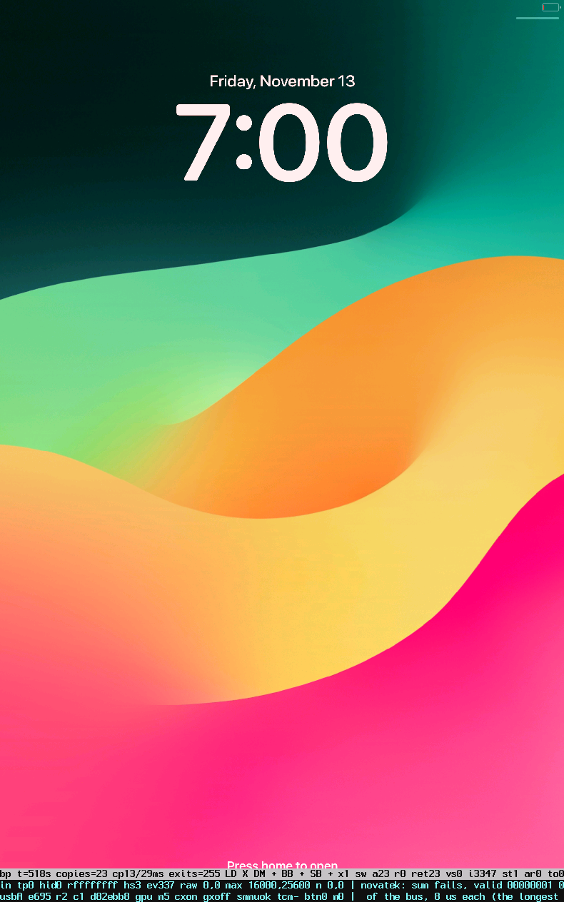
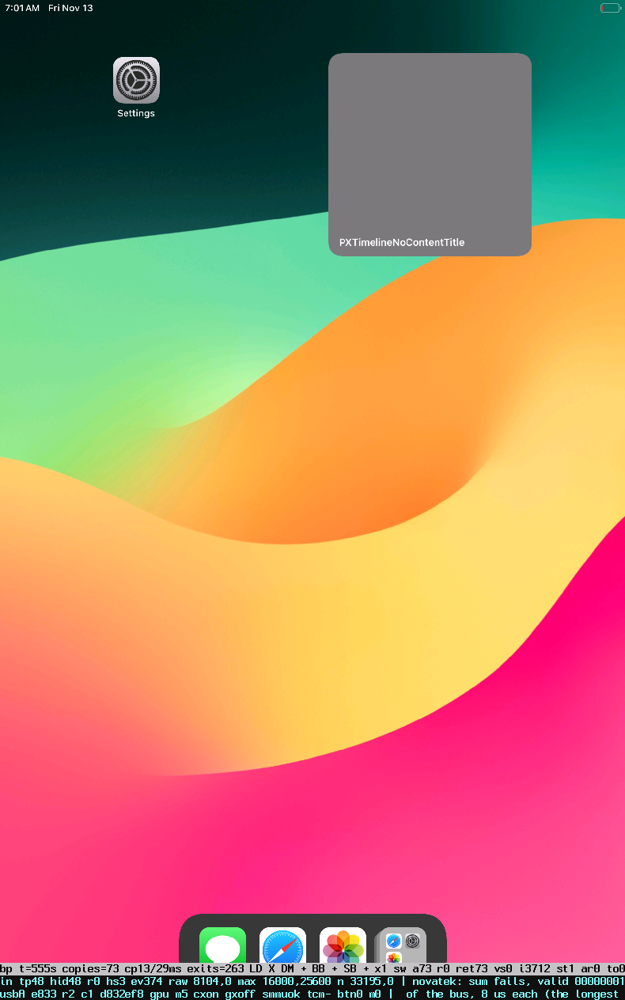
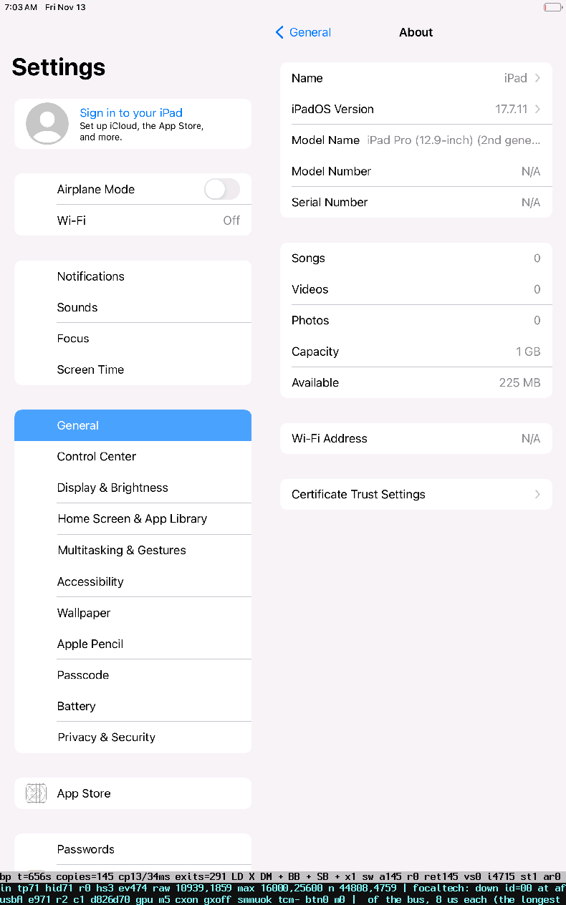
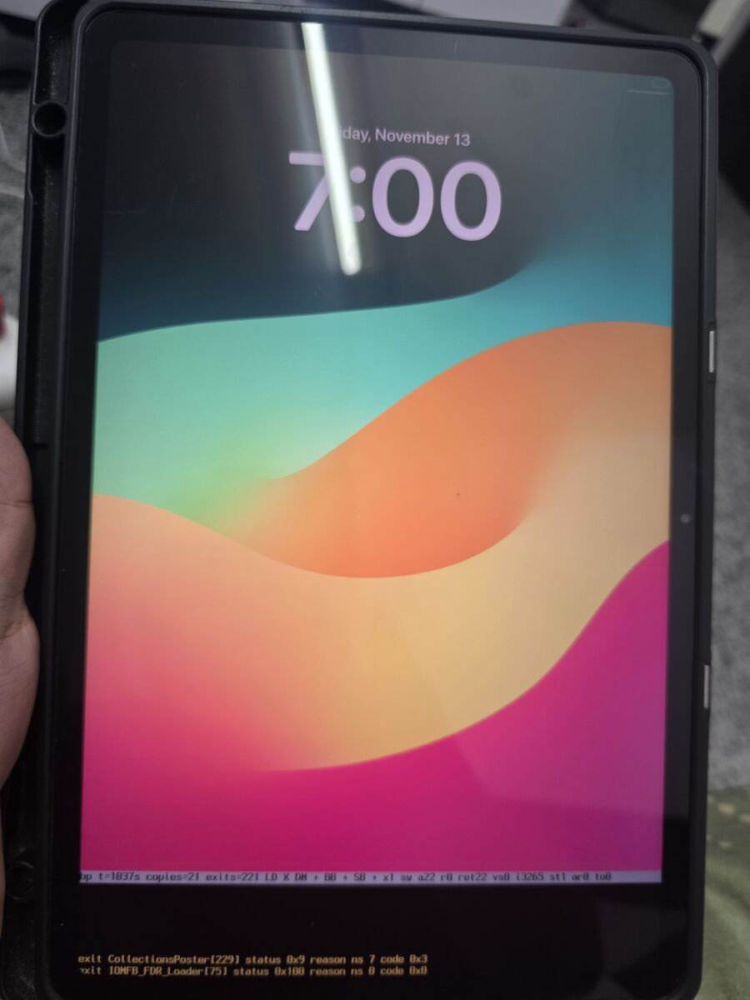
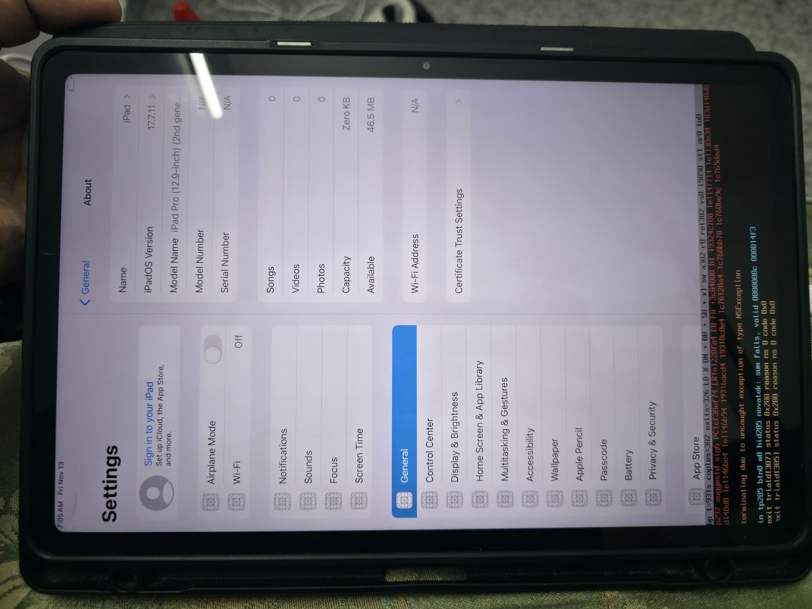

# UniXNU: iPadOS on Redmi Pad Pro 5G

UniXNU port of iPadOS 17.7.11 (21H461) to the Xiaomi Redmi Pad Pro 5G / POCO Pad 5G ("ruan", SM7435), booted RAM-only
with `fastboot boot` (nothing is flashed). Status: boots to the **iPadOS 17 home screen** with working touch, buttons, icons and wallpaper; live USB debug (screenshots, logs, reboot to fastboot). CPU-rendered (no GPU yet): the Adreno 710 bring-up is in progress (power, clocks and GMU clocks work).

  
  
   About: iPadOS 17.7.11" width="32%">

Screenshots taken from the tablet's framebuffer over the live USB debug link. The rows at the bottom are the port's
live diagnostic banner (boot time, frame copies, milestones, touch, buttons, USB and GPU state), drawn by the kernel over the iPadOS image.

**Photos of the tablet:**

  
   About on ruan (photo)" width="45%">

- [docs/IPADOS-BRINGUP.md](docs/IPADOS-BRINGUP.md): every blocker, error text, cause and fix, in order. Start here.
- [unixnu-ruan/](unixnu-ruan/): the board package (board.toml, XNU patches, kernel-side packages, build scripts, DTS).
- [docs/research/](docs/research/): GPU (offline and Adreno 710), display and method plans.

Built on [UniXNU](https://github.com/UniXNU) and its device ports (amethyst, fuxi, Dizi-Ruan, gts7xlwifi, j716f, nabu),
whose notes this work leans on. No Apple binaries, IPSW contents or vendor firmware are included: bring your own IPSW.
