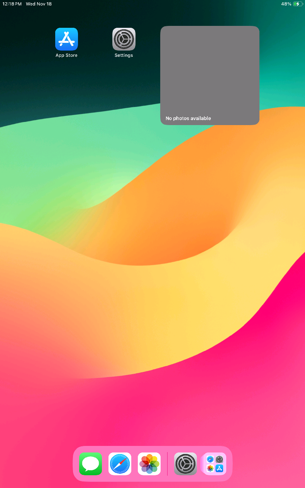
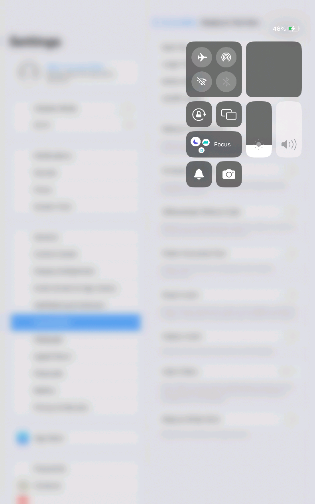
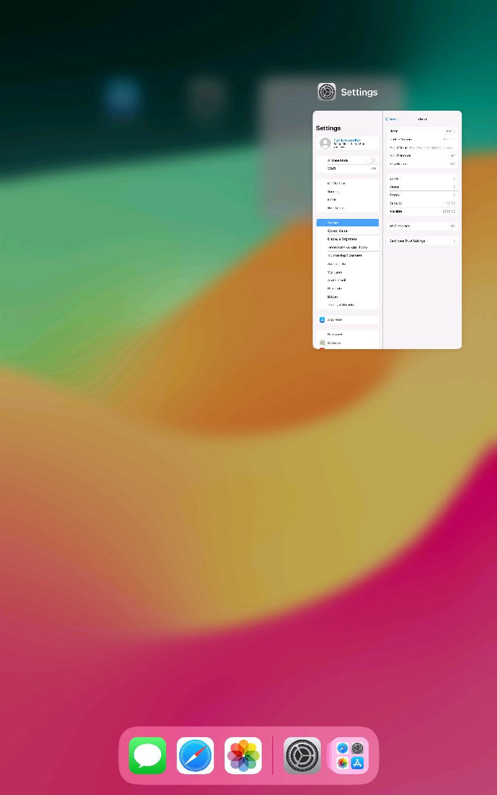
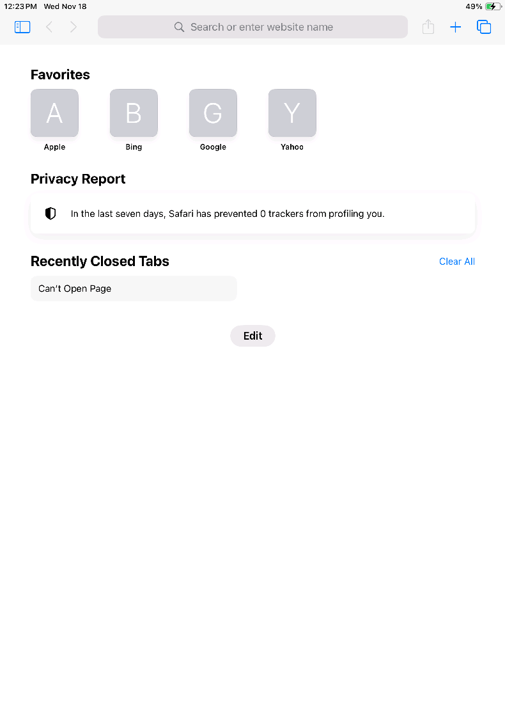
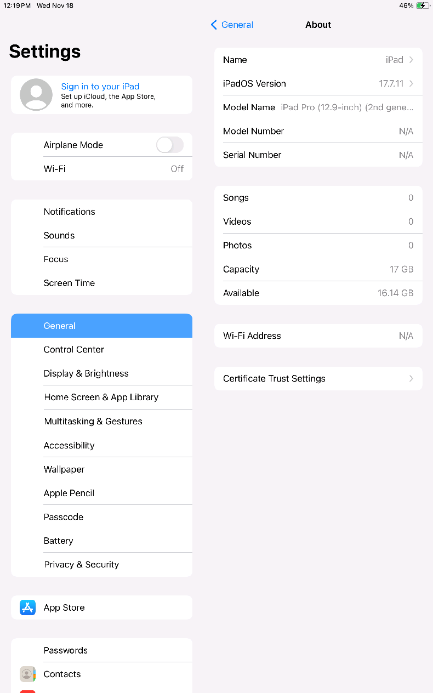
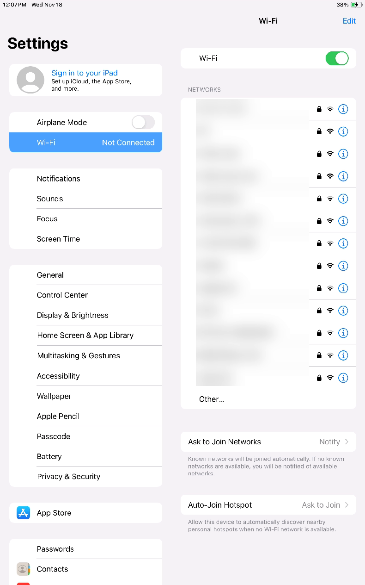

<h1 align="center">iPadOS on Redmi Pad Pro 5G</h1>

<p align="center">
  <b>iPadOS 17.7.11 running natively on the Xiaomi Redmi Pad Pro 5G ("ruan")</b><br>
  Snapdragon 7s Gen 2 (SM7435) · Adreno 710 GPU · built on <a href="https://github.com/UniXNU">UniXNU</a>
</p>

<p align="center">
  
  
  
  
  
</p>
<p align="center">
  <br>
  <sub>Native Wi-Fi (rbu173): Settings turns Wi-Fi on and lists nearby networks through iPadOS's own wifid. Network names blurred.</sub>
</p>
<p align="center"><sub>Native screenshots from the tablet (rbu172p, 2026-11-21): home screen, Control Center, app switcher, Safari, Settings → About.</sub></p>

> **Two targets, one tree:** this folder is the **iPadOS build** (boots to the home screen). The **macOS port** lives on the [`macos` branch](https://github.com/F-e-n-y-x/UniXNU-Redmi-Pad-Pro-5G/tree/macos):
> macOS 27.3 boots from internal storage and launchd spawns system daemons (2026-11-24); the full system volume is next.
> Experimental research software: it boots a real Apple OS on non-Apple hardware. Back up your device first.
>
> **Want to try it?** Read the [install guide](docs/INSTALL.md) first: it wipes Android user data, and you need your own iPadOS IPSW.

## Contents

- [What works](#what-works)
- [How it works](#how-it-works)
- [Install and setup](docs/INSTALL.md)
- [Quick start](#quick-start) (maintainers)
- [Debugging](#debugging)
- [Project layout](#project-layout)
- [Roadmap](#roadmap)
- [Credits](#credits)

## What works

Status on 2026-11-23 (last stable build: `rbu188u`). ✅ tested on the tablet · 🧪 built, being tested · ⚠️ known problem · ❌ not started

| Area | Status | Details |
|---|---|---|
| Boot | ✅ | Lock screen, home screen, Settings, Control Center |
| Storage | ✅ | iPadOS root on the internal UFS partition `sda22` (`unixnu`, 32 GiB); persistent Data volume |
| CPU | ✅ | 4× Cortex-A78 + 4× A55; load governor (A78s at 2.4 GHz under load), L3 vote, touch boost, thermal cap |
| GPU | ✅ | Metal on Adreno 710 through Turnip (Vulkan) and AdrenoMetal; multi-level clocks and governor |
| Display | ✅ | **Zero-copy scanout**: the display engine reads the GPU's frames directly, 60 Hz |
| Smoothness | ✅/⚠️ | **Fixed 2026-11-21:** the UI no longer updates only once every 5 s. Measured 16 ms frames (60 fps) in light scenes, 33 ms (30 fps) in heavier ones |
| Touch | ✅ | Every touch reaches iOS; interrupt-driven |
| Brightness | ✅ | Both SY7758 backlight chips (one per half of the LED strings) follow the slider; AppleARMBacklight conformance and full CoreBrightness calibration |
| Buttons, battery, USB debug | ✅ | |
| Power and volume keys | ✅ | Power turns the screen fully off and on; volume keys reach iOS |
| App Switcher gesture | 🧪 | Swipe up and pause: resting-finger heartbeat added (better, still tuning) |
| Power saving | 🧪 | Screen-off CPU/GPU caps; timer-bounded WFI idle and suspend-to-idle are opt-in (`ruan-idle-wfi-us`, `ruan-sleep`) |
| Crashes | 🧪 | SpringBoard respring on the home-screen pull-down found: Spotlight.app was missing; restored with a LaunchServices rescan. Turnip SIGBUS: strict-align build ready |
| App switching | ⚠️ | Closing Settings takes over 5 s and is then killed, so the switcher animation ghosts; widgets and app snapshots draw as blank boxes |
| 120 Hz | ⚠️ | Switches cleanly at 119.75 Hz with no underruns (fetch at Android's line), but frames tear; flip sync and `dpu-retire-flip=0` did not fix it. Off in the default args (60 Hz) |
| Wi-Fi | ⚠️ | **Native join works:** Settings lists networks, WPA2 and DHCP succeed in under a second (WCN6750 via WPSS, ath11k, wpa_supplicant). **But iOS doesn't use the link:** no internet, no status-bar icon, and the first join attempt always fails. Work in progress: a USB `net` report and link-quality fix (in source, untested) |
| Keyboard | 🧪 | The "moving keyboard" was iPadOS's floating keyboard (pinch out to dock). Pro layout seeded |
| Audio, Bluetooth, video decode | 🧪 | Research and staged ports in progress (`docs/research/{audio,bluetooth,video}`); hardware video decode follows UniXNU-sheng's iris VPU driver |
| Cameras, sensors, cellular | ❌ | |


### 2026-11-21: the 5-second frame stall

From rbu114u on, backboardd presented one frame every ~5.0 s, whatever the display or GPU settings. A kernel probe
(`patches/xnu/ruan-slow-wait-log.patch`) logs every user thread whose wait times out after 4 s or more, with its user return
addresses. It showed backboardd timing out in `mach_msg` after exactly 5000 ms, called from QuartzCore through
`EDRGetDefaultMinScalingFactor` in **libEDR**.

libEDR's server lives inside backboardd and starts only when CoreBrightness accepts a backlight that conforms to
`AppleARMBacklight`. The old backlight (`package/RuanBacklight.cpp`) set `backlight-control` without that conformance, so
every frame waited for a reply that never came (the same failure UniXNU recorded for sheng as int-236). The fix is the conforming
service `package/RuanBacklightSvc.cpp`, now the default (`ruan-bl-svc=0` returns to the old path). Its I2C start-up check was
relaxed in `package/GeniI2c.c` so the brightness slider works too.

Ruled out on the way: display mode, GPU clocks and governor, GPU interrupt, frame pacing, wallpaper extensions, GPU sandbox
denials, and cross-core IPIs. Turning on `armcpu-spi-ipi` / `armcpu-self-ipi` hangs boot at the display start.

## How it works

```
Android bootloader ──fastboot boot──▶ UEFI (Mu) ──▶ DarwinBoot ──▶ XNU kernel (patched, prelinked)
                                                                     │
       iPadOS root (APFS) on UFS partition sda22 ◀───────────────────┘
                                                                     │
  launchd ─▶ backboardd / SpringBoard ─▶ Metal ─▶ AdrenoMetal ─▶ Turnip ─▶ Adreno 710
                                                       │
                        display engine (DPU) ◀── zero-copy scanout of each frame
```

- **Kernel:** Apple's XNU, built from source by UniXNU with ruan's patches (`unixnu-ruan/patches/xnu/`) and drivers (`unixnu-ruan/package/`). These cover UFS storage, touch, buttons, battery, the GPU power-up (GMU/HFI), CPU frequency, the USB debug port and the display.
- **GPU:** iPadOS's Metal calls are translated to Vulkan and run by Mesa's Turnip driver on the Adreno 710.
- **Display:** frames go straight from the GPU's memory to the panel. The display engine reads them through its own SMMU window, so the CPU copies nothing.
- **Boot:** only RAM boots (`fastboot boot`). Android's partitions are untouched, apart from the shrunk `userdata` and the new `unixnu` partition.

## Install and setup

The full step-by-step guide is in **[docs/INSTALL.md](docs/INSTALL.md)**: requirements, partitioning (with backup and undo),
building the kernel, root and boot payload, flashing, boot arguments, USB debugging and going back to Android.

> [!CAUTION]
> **Experimental research software. Use it entirely at your own risk.** It can brick the tablet, it wipes Android user data,
> and you need your own, legally obtained iPadOS 17.7.11 IPSW. No Apple software or Qualcomm/Xiaomi firmware is distributed.

## Quick start

Follow [docs/INSTALL.md](docs/INSTALL.md) from step 0: it lists every input, where each one comes from, the one-time setup,
the build, and a table of common build errors. Everything the build needs is in this branch (`main`) plus public upstream
repositories pinned to exact commits; the proprietary parts are made from your own tablet by the scripts in `tools/`.

## Debugging

The kernel exposes a USB serial debug port. Use `tools/ruan-usbdbg.py`:

| Command | What it does |
|---|---|
| `shot -o screen.png` | Screenshot of what the panel shows |
| `dmesg`, `cmd info` | Kernel log, and the saved log of the previous boot |
| `pull-crashes` | All iOS crash reports (`.ips`) |
| `cmd display` / `touch` / `dpu` | Frame pacing, touch, and display-engine registers |
| `get <path>` | Copy a file off the tablet. The iOS system log is exported to `/private/var/mobile/Library/Caches/com.apple.backboardd/m2v/zz-oslog/oslog.txt.gz` |
| `reboot-fastboot` | Back to fastboot |

## Project layout

| Path | Contents |
|---|---|
| `unixnu-ruan/` | The iPadOS device port: `board.toml`, `package/` (drivers), `patches/` (XNU, Adreno, UniXNU core), `scripts/` (build) |
| `uefi/` | ruan's Mu-Silicium UEFI package (`ruanPkg`), BootShim patch, `setup-uefi-ruan.sh`, `mkxnuimg-ruan.py` |
| `third_party/hakios-tools/` | HakiOS's APFS writer, system selector and `unzbm`, used by the root build |
| `tools/` | `make-touch-fw.py`, `make-uefi-dtb.sh`, `regen-binaries.sh` (turn your tablet's files into build inputs), `ruan-usbdbg.py` (USB debug); `host/` holds the maintainers' own helper scripts (not needed to build) |
| `docs/` | `INSTALL.md` (start here), `IPADOS-BRINGUP.md` (full log), `research/` (notes, not part of the build), `hardware/`, `history/`, `img/` |
| `macos/` | Pointer to the macOS port on the [`macos` branch](https://github.com/F-e-n-y-x/UniXNU-Redmi-Pad-Pro-5G/tree/macos) |

## Roadmap

1. Wi-Fi: make iOS use the link (primary service, default route, DNS, status-bar icon); fix the failing first join.
2. 120 Hz: find the tearing cause (scanout vs. flip timing).
3. Stability: bisect the `rbu187` crash about 40 s after boot (`ruan-bt=1`, `ruan-video=1` or `ruan-vm-free-scale` 4).
4. Power: CPU big cluster stays at 2.4 GHz at 0.3 % load; then test `ruan-idle-wfi-us` and `ruan-sleep=1`.
5. Bluetooth (stages 1–3 built), audio (stage 6 not written), video decode (stages B4–B5).
6. macOS: root from the full 26C5035r system volume + SystemOS cryptex, then Data, setup skip and WindowServer (on the [`macos` branch](https://github.com/F-e-n-y-x/UniXNU-Redmi-Pad-Pro-5G/tree/macos)).

## Credits

- [UniXNU](https://github.com/UniXNU) and its device ports (sheng, dizi, amethyst, pong and others), which this port is built on.
- HakiOS (garnet), for the early root tooling and the Novatek touch driver.
- Mesa / Turnip, for the Adreno Vulkan driver.

Older notes and checkpoints (2026-11-13 … 11-19): [docs/history/](docs/history/).
