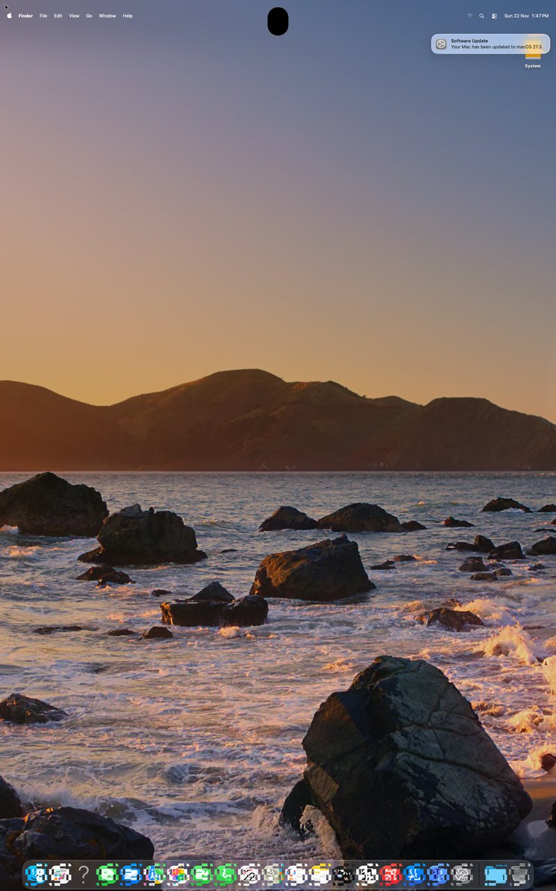
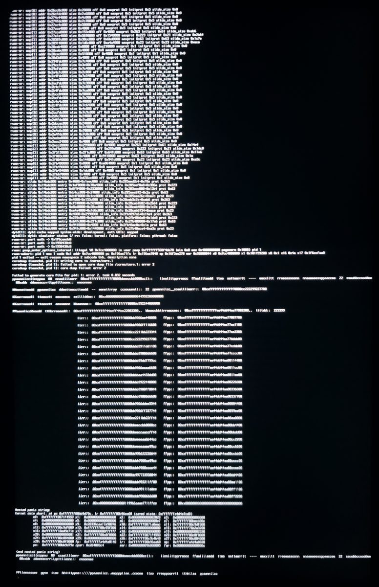

# macOS on Redmi Pad Pro 5G (ruan)

A native macOS port for the tablet, on a CPU without pointer authentication (PAC). It reuses the iPadOS port's drivers
([iPadOS port, `main` branch](https://github.com/F-e-n-y-x/UniXNU-Redmi-Pad-Pro-5G/tree/main)). This branch holds only the macOS port.

**Status (2026-11-26): first macOS desktop.** macOS 27.3 (`26C5035r`) reaches the Finder desktop with the Dock, menu bar and
wallpaper (captured over USB from the framebuffer, below). Login works (usermanagerd, SecurityAgent, auto-login), WindowServer
composes with Metal on the Adreno 710, and touch, battery, backlight and CPU clock drivers run. Open: an intermittent early reset
with the buttons driver on, a GPU hang in one boot, and slow start-up on a single A55 core (~30 min to the desktop).
Details: [docs/status-2026-11-26.md](docs/status-2026-11-26.md).

<p align="center">
  <br>
  <sub>First desktop, 2026-11-26: full-resolution framebuffer dump over the USB debug link (<code>tools/ruan-usbdbg.py fullshot</code>).</sub>
</p>

<p align="center">
  <br>
  <sub>UFS boot 10: verbose console on the tablet's panel. dyld maps the 84-file shared cache (<code>ruan-sr</code> lines: every mapping and slide),
  then launchd faults on an address above the 256 GiB user map. Fixed by the 47-bit user address space (boot 16).</sub>
</p>

Boot 17, live USB console (`tools/live-log.sh`):

```
RuanMacUfs: NativeUfs started on the platform expert device (source IOBlockStorageDevice, macOS ABI)
BSD root: disk3s1, major 1, minor 6
com.apple.xpc.launchd: boot-mode set by sysctl: main
com.apple.xpc.launchd: hello, launchd UUID: 96360FC3-2FDE-3EEE-A403-7DFCA7B44AC3
com.apple.xpc.launchd: Darwin Bootstrapper Version 7.0.0: Thu Oct 29 00:42:45 PDT 2026; root:libxpc_executables-3298.60.14~78/launchd/RELEASE_ARM64E
com.apple.xpc.launchd: boot-mode committed: main
com.apple.xpc.launchd: (system/com.apple.kernelmanagerd [3]) service state: running
com.apple.xpc.launchd: (system/com.apple.restored_external [5]) service state: running
com.apple.xpc.launchd: (system/com.apple.syslogd [4]) service state: running
```

## Progress

| Stage | Status |
|---|---|
| Kernel (plain arm64 XNU 12377, 4 KiB pages, PAC rewritten out of the kernel collection) | ✅ boots |
| Root on internal UFS (`sda22`), APFS, dyld shared cache mapped and slid | ✅ |
| launchd: bootstrap, boot tasks, spawning daemons through xpcproxy | ✅ |
| Hands-free test loop: every panic resets into fastboot; the previous boot's log comes back over USB | ✅ |
| Full macOS system volume + SystemOS cryptex as the root | ✅ |
| Data volume, setup skip, auto-login (usermanagerd persona, SecurityAgent) | ✅ |
| WindowServer (Metal on Adreno 710 via Turnip) | ✅ desktop drawn |
| Finder, Dock, menu bar | ✅ (first desktop 2026-11-26) |
| Touch (Novatek NT36532), battery, backlight, CPU clock | ✅ verified over USB |
| Buttons (power, volume) | ⚠️ works, but intermittent early reset; off by default for now |
| Speed (boot on A78 / SMP) | ⏳ staged |

## The problem: no PAC

macOS is built only for `arm64e`: every system binary uses pointer authentication, an ARMv8.3 feature. The tablet's Cortex-A78/A55
are ARMv8.2 and the hypervisor can't emulate PAC. Most PAC instructions are HINT no-ops on older CPUs; the rest (`AUT*`, `BRAA`,
`RETAA`, `LDRAA`, `PACGA`) are undefined and trap.

## The approach

1. **Kernel without PAC:** XNU 12377 (macOS 27.3, `26C5035r`) built as plain `arm64` with ruan's board patches.
2. **Kernel collection rewritten:** `tools/kc-nopac.py` rewrites the 250,332 PAC instructions in the prelinked collection.
3. **Userland rewritten:** the dyld shared cache and system binaries are rewritten (`unixnu-ruan-macos/package/pacstrip/`); the 2,114
   instructions that can't be rewritten are left to a kernel trap emulator.
4. **Ad-hoc signed root:** `tools/adhoc-resign.py` re-signs every rewritten binary and the dyld cache; their CDHashes go into an
   engineering trust cache (`amfi_get_out_of_my_way=1`).
5. **XNU fixes for arm64e userland on a non-PAC kernel:** arm64e chained fixups in the dyld pager and the shared-region slide
   (they stored signed pointers only under `ptrauth_calls`), a 47-bit user address space (xzone malloc maps at 455–512 GiB),
   16 KiB dyld fixup pages, and Darwin 26 `posix_spawnattr`. Patches in `unixnu-ruan-macos/patches/xnu-12377/`.

Background: [docs/macos-no-pac.md](docs/macos-no-pac.md) (research and blueprint), [docs/feasibility-research.md](docs/feasibility-research.md),
[docs/pac-workaround.md](docs/pac-workaround.md), [docs/scene-2026-11-13.md](docs/scene-2026-11-13.md).

## Boot log

Full details in [docs/first-boot.md](docs/first-boot.md). Boots 1–8 are RAM-only (`fastboot boot`). The UFS boots also flash the
macOS root to `sda22` (the iPadOS root there was backed up first).

| Boot | Result | Fix |
|---|---|---|
| 1 | UniXNU menu, then `'UniXNU' returned: Load Error` | wrong file-type field in the kernel collection (fileset subtype) |
| 2 | panic `arm_vm_init.c:1376` (contiguous-hint assert) | `use_contiguous_hint=0` |
| 3 | panic `recount_track_cpu_kind: element modified after free` | `ruan-recount-kind-index.patch` |
| 4 | through AMFI, IOKit and BSD init; panic on `_unsafe_kernel_text_initialized` | `ruan-no-ctrr-chosen.patch` |
| 5–7 | root mounted, launchd exec'd, AMFI kills it (unsigned) | `adhoc-resign.py` + trust cache |
| 8 | **launchd runs**; no dyld shared cache (7.1 GB, too big for RAM) | move the root to UFS |
| UFS 1–2 | NativeUfs starts on macOS, unaligned faults in its DMA buffers | aligned clears and copies, `-mstrict-align` |
| UFS 3 | root mounted from UFS; the cache is refused (`vnode is not SIP-protected`) | `lp-sip0=0x867` in the ADT |
| UFS 4–7 | cache maps; launchd SIGSEGV on a raw arm64e pointer | dyld pager and slide v3/v5 arm64e stores |
| UFS 8–9 | cache auth pointers still raw on 4 KiB parts | `ruan-shared-region-part-auth-store.patch` |
| UFS 10–14 | illegal VA, then `BUG IN LIBMALLOC: pointer range initial reservation failed` | (clamps tried, then dropped) |
| UFS 16 | **launchd runs its boot tasks**, then SIGABRT | 47-bit user VA, 16 KiB dyld fixups, pager deadlock fix (from UniXNU-sheng) |
| UFS 17 | **launchd spawns daemons**; the restore daemon exits without a restore host | the root: full OS volume next |

## Next steps

The prioritized list, with sources for every fix, is [docs/next-steps.md](docs/next-steps.md). The other macOS ports and what each
contributes are in [docs/macos-ports-survey.md](docs/macos-ports-survey.md). In short:

1. **Root:** the full `26C5035r` OS system volume plus the SystemOS cryptex, pacstripped and re-signed, on `sda22`.
2. **Data:** mount a Data volume at `/System/Volumes/Data` with firmlinks; seed it with a user, setup skipped and auto-login.
3. **Boot tasks:** `apfs_boot_util` shim, FIPS self-test re-seal, launchd `disabled.plist` (watchdogd, cameracaptured).
4. **Kernel batch:** stack alignment (AMFI dictionary copy), `no-lc=1 -no_slto_panic cs-lazy=1` and the DEVELOPMENT hygiene args.
5. **Display:** WindowServer needs a Metal device (Adreno 710 plugin, macOS build) or software rendering rules.

### What the next steps need (gathered 2026-11-24)

| Input | For | State | Where |
|---|---|---|---|
| `UniversalMac_27.3_26C5035r_Restore.ipsw` (27.2 GB, Apple CDN, URL in the UniXNU profile) | root (1) | ✅ downloaded 2026-11-24 (1801 files) | `host-work/macos-ipsw/` |
| OS system volume `141-22233-021.dmg.aea` (11.4 GB; image sha256 `40d8282e…`) | root (1) | in the IPSW; **AEA-encrypted** too | profile `[userdata] os_image_sha256` |
| SystemOS cryptex `141-22145-021.dmg.aea` (sha256 `14330ed9…`) and App cryptex (`797bb1e0…`) | root (1) | in the IPSW; **AEA-encrypted** | |
| AEA decryption (key from Apple's key service) | root (1) | blacktop `ipsw` 3.1.750 downloaded, **needs your OK to run** | `host-work/tools/ipsw-3.1.750/` |
| Space: OS + SystemOS + App ≈ 16.4 GiB | root (1) | fits the 32 GiB `sda22` | |
| Data seed, skip-setup, auto-login scripts | Data (2) | local; written for a macOS host (ditto/hdiutil), to port to the Linux mkapfs pipeline | `UniXNU-macos/scripts/make-macos-data-seed.py`, `seed-data-skip-setup.py`, `make-macos-autologin-addon.py` |
| Data mount config | Data (2) | sheng's defconfig lines to copy | `UniXNU-sheng/configs/sheng_macos_defconfig` |
| `apfs_boot_util` shim source | boot tasks (3) | local; build for arm64e, re-sign | `UniXNU-macos/scripts/macos-boot-shims/apfs_boot_util.c` |
| FIPS HMAC re-seal (`fips26.py`, MIT) | boot tasks (3) | local clone | `refs/macos-ports/oosexgang__hakios-xnu-kernel/darwin/tools/fips26.py` |
| Stack alignment, edge matrix | kernel (4) | local | `UniXNU-sheng/patches/xnu-12377/zzzz-sheng-ipados27-bringup.patch` (stack.c hunk), `zzzzzzzzzzz-sheng-edge-matrix.patch` |
| Adreno Metal plugin for macOS 27 | display (5) | not built: `build-ruan-adreno.py` is not in the macOS archives | iPadOS board on [`main`](https://github.com/F-e-n-y-x/UniXNU-Redmi-Pad-Pro-5G/tree/main) |
| Tablet in fastboot on the Pi 5, `live-log.sh macos` | every test | ready | `tools/` |

`host-work/` is the local build area (not in git; Apple binaries, large). The `UniXNU-*` and `refs/` paths are under
`/root/unixnu-work`, a bind mount of it (run `tools/mount-host-work.sh` after a PC restart).

## Documentation

| Doc | What it covers |
|---|---|
| [docs/first-boot.md](docs/first-boot.md) | The boot log: every boot (RAM 1–8, UFS 1–17), what it showed, the cause and the fix |
| [docs/next-steps.md](docs/next-steps.md) | Prioritized roadmap from "launchd runs" to "desktop on screen", with the source of each fix |
| [docs/macos-ports-survey.md](docs/macos-ports-survey.md) | Other macOS-on-ARM / UniXNU ports and what each one contributes here |
| [docs/macos-no-pac.md](docs/macos-no-pac.md) | Research and blueprint: running arm64e macOS on a CPU without PAC |
| [docs/pac-workaround.md](docs/pac-workaround.md) | The PAC workaround in detail: kernel collection rewrite, pacstrip, trap emulator |
| [docs/feasibility-research.md](docs/feasibility-research.md) | Early feasibility study for native macOS on ruan |
| [docs/macos-sonoma-sequoia-port.md](docs/macos-sonoma-sequoia-port.md) | Older blueprint for macOS 14/15 (kept for reference) |
| [docs/scene-2026-11-13.md](docs/scene-2026-11-13.md) | Snapshot of the XNU / macOS-on-Android scene |
| [docs/agy-macos-no-pac-task.md](docs/agy-macos-no-pac-task.md) | The original task brief |
| [unixnu-ruan-macos/README.md](unixnu-ruan-macos/README.md) | The macOS board directory |

## Folder

| Path | Contents |
|---|---|
| `unixnu-ruan-macos/` | The macOS board dir (a fork of the iPadOS board `unixnu-ruan/` on [`main`](https://github.com/F-e-n-y-x/UniXNU-Redmi-Pad-Pro-5G/tree/main) plus the macOS changes; it lags the iPadOS drivers): `board.toml`, `configs/ruan_macos*_defconfig`, `patches/xnu-12377/` (`series` + `ufs.series`), `package/RuanMacUfs.cpp` (UFS root start), `package/pacstrip/`, `scripts/build-ruan-mac-ufs.py` |
| `unixnu-core-macos/` | Changes to the UniXNU checkout used for macOS, as patches (`apply.sh <UniXNU>`; commits in `COMMITS.txt`) |
| `tools/` | `build-macos-ramroot.sh` (kernel + boot set; `UFS=1` for the UFS root), `make-macos-ufs-board.sh` (UFS board variant), `make-macos-ufs-root.py` (the `sda22` image), `rebuild-macos-root.py`, `adhoc-resign.py` (ad-hoc signing + CDHashes), `cache-addr.py` (runtime address → cache library), `kc-nopac.py`, PAC and CPU-feature scans |
| `docs/` | Boot log, next steps, ports survey, research |

Not in git (Apple binaries, large): the work trees `host-work/UniXNU-macos` and `host-work/UniXNU-ruan-macos` (live copies of
the two folders above), build outputs in `host-work/macos-build/out/`, the extracted restore files in `host-work/macos-extract/`
(recovery root, dyld cache, `unixnu-macos-root.img` for `sda22`), and logs in `host-work/logs/macos-ufs1/`.

## Run a UFS boot

```bash
tools/mount-host-work.sh                                    # after a PC restart
UFS=1 tools/build-macos-ramroot.sh                         # -> host-work/macos-build/out/ruan-ramroot-usb-macos.img
python3 tools/make-macos-ufs-root.py /root/unixnu-work/macos-extract /root/unixnu-work/macos-extract/unixnu-macos-root.img
# copy both images to the Pi 5 (tablet on its USB, in fastboot), then on the Pi:
fastboot flash unixnu unixnu-macos-root.img
fastboot boot ruan-ramroot-usb-macos.img
./live-log.sh macos                                              # live console; a panic resets into fastboot after 15 s
```

`ruan-panic-fastboot=0` keeps the panic on screen instead. To return to iPadOS, restore `sda22` from
`host-work/backups/` (steps in its README).

## Credits

[UniXNU](https://github.com/UniXNU): UniXNU-sheng (47-bit user VA, 16 KiB dyld fixups, Darwin 26 spawn attributes, the macOS Data
and boot-task work); darwin-lisa / Bergamota for the PAC-neutralisation approach; BxiiDN/macOS-Pad-6 for the SM8250 pacstrip work;
oosexgang/hakios-xnu-kernel (MIT) for the FIPS re-seal.
