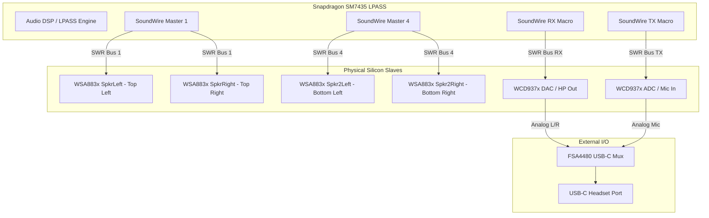

# Audio Subsystem Architecture (Quad WSA883x + WCD937x + SoundWire)

**Target Device**: Xiaomi Redmi Pad Pro 5G / POCO Pad 5G ("ruan")  
**SoC**: Qualcomm Snapdragon SM7435  
**Speaker Topology**: Quad-Speaker Stereo Array (4x Qualcomm WSA883x Smart Amplifiers)  
**Headphone / Mic Codec**: Qualcomm WCD937x Codec (`wcd9370` / `wcd9375`)  
**Bus Architecture**: SoundWire (MIPI DisCo SWR Master 1 & Master 4)  
**USB-C Audio Mux**: Fairchild / ON Semi FSA4480 I2C analog switch (`0x42`)  
**Status**: Research & Driver Architecture Blueprint

---

## 1. Hardware Survey & Device Tree Mapping

From live device tree (`ruan-live.dts`):

```
SoundWire Macro Subsystems:
  1. WSA Macro (Base: 0x31e0000)
     Master: wsa_swr_master (ID: 0x01)
     Slaves:
       - wsa883x@02170221: Left Channel 1 ("SpkrLeft")
       - wsa883x@02170222: Right Channel 1 ("SpkrRight")

  2. WSA2 Macro (Base: 0x31e0000)
     Master: wsa2_swr_master (ID: 0x04)
     Slaves:
       - wsa883x@02170221: Left Channel 2 ("Spkr2Left")
       - wsa883x@02170222: Right Channel 2 ("Spkr2Right")

Codec Subsystem:
  - wcd937x-codec (status = "okay"):
      rx-slave = <0x559> (SoundWire RX macro)
      tx-slave = <0x55a> (SoundWire TX macro)
      rst-gpio = TLMM GPIO reset
      Headphone jack / analog mic bias: 1080 mV - 1800 mV

USB-C Audio Switch:
  - fsa4480@42 (I2C handle 0x367):
      Multiplexes USB-C CC lines to analog audio L/R/Mic/GND
```

---

## 2. Bus Architecture & Signal Routing



---

## 3. Apple XNU Audio Stack Integration

In macOS / iOS, audio runs through `CoreAudio` and the `IOAudioFamily` I/O Kit framework:

### Driver Approaches:

1. **Approach A: Native `IOAudioDevice` Kernel Driver (`RuanAudioDevice`)**:
   - Publishes `IOAudioEngine` and `IOAudioStream` into the IORegistry.
   - Configures DMA buffer in LPASS memory (`audio_cma_region` at physical DRAM).
   - Manages SoundWire frames via Qualcomm LPASS registers (`0x31e0000`).
   - Handles volume, mute, and speaker protection curves.

2. **Approach B: CoreAudio AudioServerPlugIn (HAL Userland Driver)**:
   - Implements an Apple CoreAudio HAL plugin (`RuanAudioPlugin.driver`).
   - Directly drives a userspace PCM ringbuffer over a character device or shared memory.
   - Communicates with a lightweight LPASS daemon that toggles FSA4480 and SoundWire amplifiers.
   - *Advantages*: Zero kernel panic risk, easier debugging, full access to CoreAudio floating-point DSP pipelines.

---

## 4. Initialization & Playback Sequence

1. **Power & Clocks**:
   - Vote on `lpass_core_hw_vote` and `lpass_audio_hw_vote` via cmd-db.
   - Power up WSA macro power supplies: `cdc-vdd-1p8` (1.8V), `cdc-vdd-buck` (1.8V).
2. **SoundWire Enumeration**:
   - Send SoundWire Sync and Preamble.
   - Discover WSA883x slaves at addresses `0x02170221` and `0x02170222`.
   - Program port mapping: 2 channels per master, 48 kHz / 16-bit or 24-bit PCM.
3. **Amplifier Unmute**:
   - Write WSA883x gain and class-D modulation registers.
   - De-assert speaker shutdown GPIOs (`spkr-sd-n-node`).
