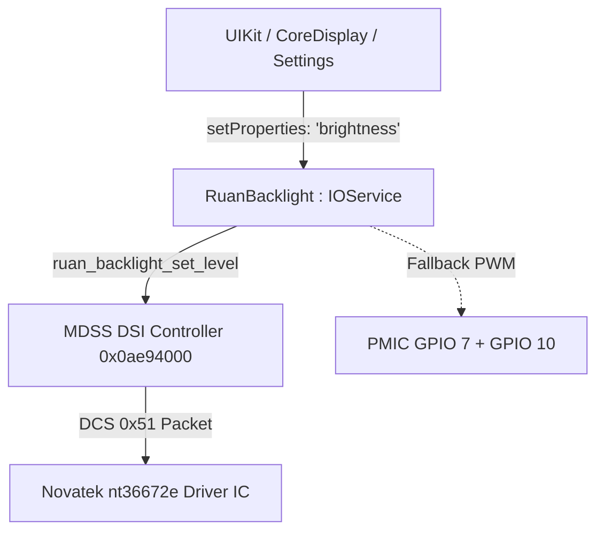

# Novatek NT36672E Display Backlight Architecture & Driver Implementation

**Target Device**: Xiaomi Redmi Pad Pro 5G / POCO Pad 5G ("ruan")  
**SoC**: Qualcomm Snapdragon SM7435 (7s Gen 2)  
**Panel**: Novatek `nt36672e` 12.1" LCD, 2560x1600 (WQXGA), DSI video mode with DSC  
**Status**: Driver drafted (`RuanBacklight.h` / `RuanBacklight.cpp`)

---

## 1. Hardware Survey & Register Topology

From live device tree inspection (`ruan-live.dts`):

```
DSI Controller 0:
  Base Address: 0x0ae94000 (Length: 0x1000)
  Interrupt: GIC SPI 0x11f
  Clocks: byte_clk, pixel_clk, esc_clk

Novatek Panel (nt36672e):
  Type: dsi_video_mode with DSC compression
  Resolution: 1600x2560 (portrait)
  Blackness Level: 0x1361 (4961)
  Peak Brightness: 0x626b50
  DSI DCS Brightness Command: 0x51 (Write Display Brightness)
  DSI DCS Control Command: 0x53 (Write CTRL Display)

GPIO / PMIC Fallback:
  Backlight PWM: TLMM GPIO 7 (function func1)
  Backlight Enable: TLMM GPIO 10 (function normal)
```

---

## 2. MIPI DSI DCS Brightness Control Protocol

The Novatek NT36672E panel driver IC accepts standard MIPI DCS (Display Command Set) brightness packets directly over the DSI link:

### Command 0x51: Write Display Brightness
- **Payload Format**: 12-bit brightness value ($0 \dots 4095$).
- **Byte 0**: `0x51` (DCS Command opcode).
- **Byte 1**: `(level >> 8) & 0x0F` (Upper 4 bits of brightness).
- **Byte 2**: `level & 0xFF` (Lower 8 bits of brightness).
- **DSI Packet Transmission**:
  ```
  Type: 0x39 (DSI Long Packet Write)
  Data: [39 01 00 00 00 00 03 51 MSB LSB]
  ```

### Command 0x53: Write CTRL Display
- Controls backlight enabling and PWM mode:
  - `0x2C`: BCTRL = 1 (Backlight control enabled), BL = 1 (Backlight turned on).
  - Packet: `[39 01 00 00 00 00 02 53 2C]`

---

## 3. Apple XNU / Darwin Driver Architecture

In Apple XNU, brightness is managed by `AppleBacklight` and `IODisplayParameters`:



### Published IORegistry Properties
`RuanBacklight` registers under the display subsystem with:
* `brightness`: Current level ($0 \dots 4095$).
* `brightness-min`: Minimum level ($0$).
* `brightness-max`: Maximum level ($4095$).
* `IODisplayParametersCommit`: `kOSBooleanTrue`.

### Driver Files
* Header: [RuanBacklight.h](file:///DATA/tower/Projects/Redmi%20Pad%20Pro%205G/macOS/unixnu-ruan/package/RuanBacklight.h)
* Implementation: [RuanBacklight.cpp](file:///DATA/tower/Projects/Redmi%20Pad%20Pro%205G/macOS/unixnu-ruan/package/RuanBacklight.cpp)
