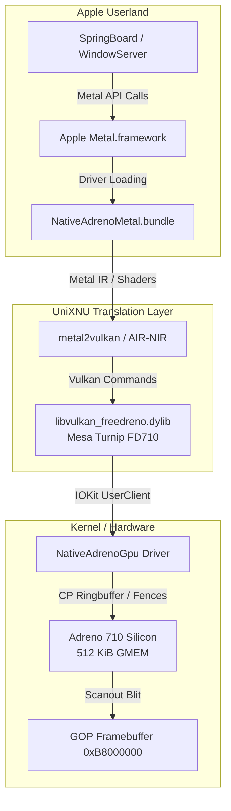

# Adreno 710 Metal & Mesa Turnip Hardware Acceleration Roadmap

**Target Device**: Xiaomi Redmi Pad Pro 5G / POCO Pad 5G ("ruan")  
**SoC**: Qualcomm Snapdragon SM7435  
**GPU Core**: Adreno 710 (`gen7_3_0`, chip ID `0x07010000`, 512 KiB GMEM)  
**Target Milestone**: Full 60 FPS Hardware Metal Acceleration on SpringBoard / macOS WindowServer  
**Status**: Stage S1–S5 Verified; Entering Userspace Driver Pipeline

---

## 1. Executive Summary & Hardware Verification Status

The Adreno 710 GPU on ruan has already completed its foundational in-kernel stages on physical silicon:
- ✅ **Stage S1**: CX/GX GDSC power domains active, GPU clocks running, SMMU readable.
- ✅ **Stage S2**: GMU firmware (`gmu_gen70000.bin`) verified and booted, HFI handshake established.
- ✅ **Stage S3**: SQE microcode (`a710_sqe.fw`) and OEM Zap shader (`a710_zap.mdt`) authenticated under Gunyah hypervisor via SCM PAS 13.
- ✅ **Stage S4**: Command processor (CP) ringbuffer submissions, fences, and memory contexts verified.
- ✅ **Stage S5**: Mode 16 DMA blitter (`CP_MEMCPY` packet 0x75) executed on live panel scanout (40,000 pixels in ~45 µs).

The remaining task is transitioning from CPU software rasterization to **full userspace Metal acceleration**.

---

## 2. The Acceleration Pipeline

---

## 3. Two Complementary Display Milestones

### Milestone 1: 0% CPU Display Blit (Hardware 2D Scanout)
- **Goal**: Offload the continuous 1600x2560 frame copy from CPU write-combined memory (`fb-wc=1`, 13–16 ms) to the Adreno 710 CP_MEMCPY DMA engine (~45 µs).
- **Implementation**:
  - Gated behind `fb-gpu-stream=1` in `LegacyDisplayProbe.cpp`.
  - Fix: Eliminate synchronous `flush_dcache64(16MB)` per frame; use write-combined memory descriptors.
  - Multi-frame double-buffering: Surface $A$ is scanned out while Surface $B$ is blitted.
  - Asynchronous completion via `native_legacy_gpu_complete(display, 0)`.

### Milestone 2: Full 3D Metal Acceleration (Zero CPU Rasterization)
- **Goal**: UIKit, CoreAnimation, SpringBoard, and app windows do not rasterize on CPU; all geometry, shaders, and blur effects render on Adreno 710 shader cores.
- **Implementation Steps**:
  1. **Build Mesa Turnip FD710**:
     - Run `build-turnip-darwin.py --target ios` with `turnip-darwin-kmd.patch`.
     - Target: `libvulkan_freedreno.dylib` compiled for `arm64-apple-ios17.0`.
  2. **Build NativeAdrenoMetal Plugin**:
     - Run `build-adreno-metal-plugin.py`.
     - Produces `NativeAdrenoMetal.bundle` housing the Metal-to-Vulkan translation layer.
  3. **Publish IOKit Service**:
     - Call `native_adreno_publish()` in XNU kernel to register `NativeAdrenoGpu` in IORegistry.
     - Add `NativeSandboxGrantProcess="backboardd"` to allow SpringBoard and Backboardd to open the accelerator.
  4. **Package into GpuAddon**:
     - Pack files using `make-gpu-addon.py --publish` into `GpuAddon` payload block.
     - Boot with `gpu-addon=1` to auto-extract into `/private/var/ngpu/addons/`.
  5. **Surface Compression Fixups (Data Seed)**:
     - Set `CAEnableFramebufferCompression = false` and `CAEnableIOSurfaceCompression = false` to prevent unsupported Apple compressed two-plane surfaces (`b3a8`).

---

## 4. Build-by-Build Execution Matrix

| Build | Focus | Expected Silicon Output |
|---|---|---|
| **rbu23** | Continuous GPU DMA Blitter (`fb-gpu-stream=1`) | `copies=0`, `gpu_blits > 1000`, 0% CPU blit overhead |
| **rbu24** | Publish `NativeAdrenoGpu` Service | `NativeAdrenoGpu` published in IORegistry; user clients attach |
| **rbu25** | Build Turnip FD710 & NativeAdrenoMetal | Inject `GpuAddon` into ramroot; Backboardd loads Metal plugin |
| **rbu26** | Backboardd Metal Handshake | Backboardd opens GPU slot 0; first Vulkan device created |
| **rbu27** | IOSurface Swapchain Interop | SpringBoard renders frames directly to Vulkan-backed IOSurfaces |
| **rbu28** | Dynamic Shader Cache & Blur | Full GPU blur and CoreImage acceleration without CPU fallback |
| **rbu29+** | 60 FPS Glitch-Free Polish | Rock-solid continuous 60/120 Hz Metal UI across iPadOS and macOS |
