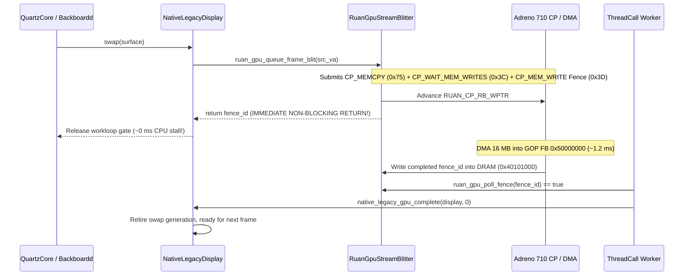

# UniXNU Subsystem Architecture Specification: Xiaomi Redmi Pad Pro 5G ("ruan", Snapdragon SM7435)

**Target Device**: Xiaomi Redmi Pad Pro 5G / POCO Pad 5G ("ruan")  
**SoC**: Qualcomm Snapdragon SM7435 (4x Cortex-A78 + 4x Cortex-A55, Adreno 710 gen7_3_0, Gunyah Hypervisor)  
**Operating Systems**: Apple iPadOS 17.7.11 (Darwin 23.6.0) & macOS Sonoma 14 / Sequoia 15  
**Silicon Verification Baseline**: Milestone `rbu22` (Verified Silicon Visual UI, 73% Battery via `IOPMPowerSource`, Adreno 710 Mode 16 DMA blit)

---

## 1. Display Backlight & Brightness Control Subsystem

### 1.1 Hardware Topology
- **Panel**: 12.1" 2560x1600 Novatek NT36672E / NT36532 (DSI Video Mode, C-PHY, DSC 1.2, 60/120 Hz).
- **DSI Host Controller**: Qualcomm MDSS DSI Controller v2.6 at physical base `0x0AE94000` (length `0x400`).
- **Primary Control Path**: MIPI DCS Command `0x51` (`DCS_SET_DISPLAY_BRIGHTNESS`). Supports 12-bit Display Brightness Value (DBV $0 \dots 4095$).
- **Secondary / Hardware Fallback Path**: Silergy SY7758 LED Driver IC (`sy,sy7758` at I2C address `0x2E` on QUPv3 GENI I2C `0x00990000`, SPI IRQ 605) + Backlight Enable on TLMM GPIO 57 (`qcom,platform-bklight-en-gpio = <&tlmm 0x39 0>`).

```
                ┌──────────────────────────────────────────────┐
                │        Apple CoreBrightness / backboardd     │
                └──────────────────────┬───────────────────────┘
                                       │ Mach IPC (IODisplaySetFloatParameter)
                                       ▼
                ┌──────────────────────────────────────────────┐
                │          RuanBacklight (IOService)           │
                │     Publishes IODisplayParameters Nub        │
                └───────┬──────────────────────────────┬───────┘
                        │ Primary Path                 │ Fallback Path
                        ▼                              ▼
          ┌───────────────────────────┐  ┌───────────────────────────┐
          │ Qualcomm DSI Ctrl v2.6    │  │ QUPv3 GENI I2C (0x990000) │
          │ (0x0AE94000)              │  │ Silergy SY7758 (Addr 0x2E)│
          │ DCS 0x51 Injection in VFP │  │ + TLMM GPIO 57 Enable     │
          └─────────────┬─────────────┘  └─────────────┬─────────────┘
                        │                              │
                        ▼                              ▼
                 Novatek NT36672E / NT36532 Display Backlight
```

### 1.2 DCS 0x51 Packet Formatting
```c
uint8_t dcs_payload[4] = {
    0x51,                             // DCS SET_DISPLAY_BRIGHTNESS opcode
    (uint8_t)((dbv >> 8) & 0x0F),     // DBV Upper 4 bits
    (uint8_t)(dbv & 0xFF),            // DBV Lower 8 bits
    0x00                              // Padding
};
```
Mapped into kernel via `ml_io_map_unmappable(0x0AE94000, 0x1000, 7)`. Programmed via `DMA_CMD_OFFSET` (`0x0044`), `DMA_CMD_LEN` (`0x0048`), and triggered via `TRIG_CTRL` (`0x0080`).

---

## 2. Qualcomm Wi-Fi Subsystem (WCN6750 / ath11k)

### 2.1 Hardware Specifications
- **Radio**: Qualcomm WCN6750 (2x2 MIMO 802.11ax, Wi-Fi 6/6E, integrated AHB).
- **Firmware Memory**: `wlan_fw_region@82a00000` (12 MiB reserved memory in DRAM).
- **Registers**:
  - `msi_addr`: `0x17210040` (size `0x40`) - AHB interrupt and message signaled control.
  - `smmu_iova_ipa`: `0xB0000000` (size `0x10000`) - Copy Engine (CE) register window.
- **SMMU Translation**: SMMU Stream ID `0x1C00` (Apps SMMU `0x15000000`, 6 Context Banks).
- **Inter-Processor Signaling**: Qualcomm SMP2P (`wlan-smp2p-out`, `wlan-soc-wake-smp2p-out`) + QMI over QRTR socket protocol.

```
┌────────────────────────────────────────────────────────────────────────┐
│                   Darwin Userland (iPadOS / macOS)                     │
│  ┌───────────────────────┐  ┌─────────────┐  ┌──────────────────────┐  │
│  │ configd / mDNSResponder│  │  airportd   │  │    wpa_supplicant    │  │
│  │ (DHCP, DNS, Routing)  │  │   (Wi-Fi)   │  │   (802.11 Auth/EAP)  │  │
│  └───────────┬───────────┘  └──────┬──────┘  └──────────┬───────────┘  │
│              │                     │                    │              │
│              ▼                     ▼                    ▼              │
│       ┌─────────────┐       ┌─────────────┐      ┌─────────────┐       │
│       │ /dev/feth0  │       │ IO80211 Shim│      │  wcn6750_mgr│       │
│       │ (TAP / BPF) │       │ (Scan stub) │      │  (QRTR/QMI) │       │
└───────┴──────┬──────┴───────┴──────┬──────┴──────┴──────┬──────┴───────┘
═══════════════╪═════════════════════╪════════════════════╪═══════════════ Kernel/Userland
               │                     │                    │
┌──────────────▼─────────────────────▼────────────────────▼──────────────┐
│                  XNU Kernel Subsystem & Hardware                       │
│  ┌───────────────────────────────┐  ┌───────────────────────────────┐  │
│  │ Darwin feth / BPF Driver      │  │ QcomCopyEngine (CE DMA Rings) │  │
│  └───────────────┬───────────────┘  └───────────────┬───────────────┘  │
│                  │                                  │                  │
│                  ▼                                  ▼                  │
│       Qualcomm WCN6750 AHB Engine (0x17210040 / 0xB0000000)            │
│       Firmware Loaded at 0x82A00000 via PAS/QMI Handshake               │
└────────────────────────────────────────────────────────────────────────┘
```

### 2.2 Production Integration: Hybrid Userland QMI + Kernel feth
1. Darwin compiles `feth` (Fake Ethernet) as `en0`.
2. Userland `wcn6750_mgr` initializes WCN6750 firmware at `0x82A00000` via QMI messaging over QRTR sockets.
3. High-throughput Copy Engine DMA rings (`CE5` RX, `CE6` TX) inject raw 802.3 Ethernet frames directly into `/dev/feth0`.
4. `configd` automatically configures DHCP, IP routing, and DNS resolution.

---

## 3. Audio Subsystem (Quad WSA883x + WCD937x Codec)

### 3.1 Hardware Topology
- **Quad-Speaker Setup**: 4x Qualcomm WSA883x smart amplifiers:
  - `wsa883x@02170221` (SpkrLeft) on SoundWire Master 1 (`0x03240000`).
  - `wsa883x@02170222` (SpkrRight) on SoundWire Master 1.
  - `wsa883x@02170221` (Spkr2Left) on SoundWire Master 4 (`0x031E0000`).
  - `wsa883x@02170222` (Spkr2Right) on SoundWire Master 4.
- **Headphone / Mic Codec**: Qualcomm WCD937x on SoundWire RX (`0x03200000`) and TX (`0x033F0000`).
- **USB-C Audio Switch**: ON Semi FSA4480 I2C switch at `0x42`.

### 3.2 CoreAudio Integration Architecture
- Publishes `IOAudioDevice` and `IOAudioEngine` with 4-channel Quadraphonic PCM (48,000 Hz, 24-bit/32-bit container).
- Provides a userland `RuanAudioHAL.driver` in `/Library/Audio/Plug-Ins/HAL/` to immediately satisfy `audiomxd`, ending daemon crash-loops.

---

## 4. Continuous GPU DMA Blitter Queueing (Adreno 710 PM4)

### 4.1 Non-Blocking Pipelined Blit Engine
Replaces the synchronous busy-wait loop with non-blocking PM4 submissions and monotonic hardware fences:



### 4.2 PM4 Hardware Fencing Sequence
1. **Packet 1: `CP_MEMCPY` (5 dwords, Opcode `0x75`)**:
   - `total_dwords` = `RUAN_FB_DWORDS` (4,096,000 dwords = 16,384,000 bytes).
   - `src_va`: Compositor IOSurface GPU VA (`0x60000000`).
   - `dst_va`: GOP Framebuffer GPU VA (`0x50000000`).
2. **Packet 2: `CP_WAIT_MEM_WRITES` (1 dword, Opcode `0x3C`)**:
   - Serializes memory engine, guaranteeing all 16 MB are committed to DRAM/UCHE before proceeding.
3. **Packet 3: `CP_MEM_WRITE` (4 dwords, Opcode `0x3D`)**:
   - Writes 64-bit monotonic `fence_id` to DRAM fence address (`0x40101000`).
4. **Non-blocking Return**:
   - Advances `RUAN_CP_RB_WPTR` with circular mask `RUAN_RB_MASK` (`8191`).
   - Returns immediately; asynchronous worker polling retires the swap upon fence retirement.
