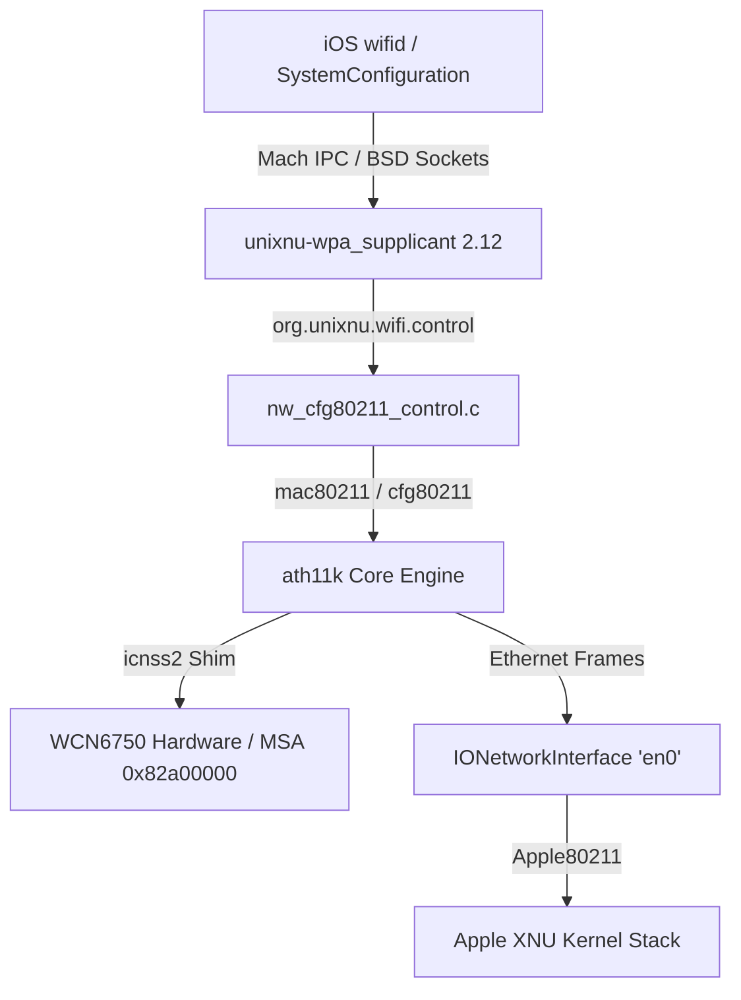

# Qualcomm WCN6750 Wi-Fi & Bluetooth Bring-Up Architecture

**Target Device**: Xiaomi Redmi Pad Pro 5G / POCO Pad 5G ("ruan")  
**SoC**: Qualcomm Snapdragon SM7435 (7s Gen 2 / "parrot")  
**WLAN Silicon**: Qualcomm WCN6750 (Integrated Wi-Fi 6 2x2 MIMO + Bluetooth 5.2)  
**Status**: Research & Driver Architecture Blueprint

---

## 1. Hardware Topography & Device Tree Survey

From live hardware device tree (`ruan-live.dts`):

```
WCN6750 Subsystem:
  Node: /soc/qcom,wcn6750
  Compatible: "qcom,wcn6750"
  MMIO Ranges:
    - 0x17210040 (Length: 0x0)
    - 0xb0000000 (Length: 0x10000)
  
Firmware / MSA Memory Regions:
    - wlan_fw_region@82a00000: Base 0x82a00000, Size 0x00c00000 (12 MiB) [no-map]
  
Inter-Processor Signaling:
    - SMP2P: "wlan-smp2p-out", "wlan-soc-wake-smp2p-out", "wlan-ep-powersave-smp2p-out"
    - QMI Device: "wlan"
  
Bluetooth Node:
    - /soc/bt_wcn6750 (compatible: "qcom,wcn6750-bt")
```

---

## 2. Architecture Comparison: WCN6750 (ruan) vs WCN7850 (sheng)

| Feature | WCN7850 (SM8550 / sheng) | WCN6750 (SM7435 / ruan) |
|---|---|---|
| **Bus Interface** | External PCIe Gen 3 | Integrated AHB / Internal Bus |
| **Driver Model** | Linux `ath12k_pci` | Linux `ath11k_ahb` (`qcom,wcn6750`) |
| **Host Driver Framework** | `MhiBoot` + `Ath12kWifi` | `icnss2` (Integrated Chip Network SubSystem) + `ath11k` |
| **Memory Architecture** | Host PCIe BARs + 128 MB DMA Window | MSA (Modem Self-Authentication) memory at `0x82a00000` (12 MiB) |
| **Control Protocol** | MHI (Modem Host Interface) state machine | QMI (Qualcomm Messaging Interface) over IPC Router |

---

## 3. Darwin / Apple XNU Wi-Fi Integration Strategy

To bring up WCN6750 on Apple XNU, we leverage the architecture proven by UniXNU's `Ath12kWifi`:



### Key Subsystem Components:

1. **`RuanWifiProbe` (Hardware Bringup & Power Sequence)**:
   - Sets up clocks: `gcc_wlan_ahb_clk`, `gcc_wlan_axi_clk`.
   - Asserts SMP2P handshake with remote processor (WPSS/Modem).
   - Reserves and protects MSA DRAM window at `0x82a00000` (12 MiB) using `owned_memory_outside_reserved`.

2. **QMI Handshake (`qcom,qmi-dev-name = "wlan"`)**:
   - Sends `QMI_WLFW_IND_REGISTER_REQ`.
   - Sends `QMI_WLFW_MSA_INFO_REQ` passing physical base `0x82a00000` and size `0xC00000`.
   - Receives `QMI_WLFW_FW_READY_IND` when firmware boots.

3. **`Ath11kWifi` Kernel Shim**:
   - Adapts Linux `ath11k_ahb` to Darwin's `include/nw_abi.h`.
   - Implements zero-copy DMA packet translation: mbuf $\longleftrightarrow$ sk_buff.
   - Binds `en0` to Apple's `IONetworkingFamily` / `Apple80211`.

4. **Userspace Authentication (`unixnu-wpa_supplicant`)**:
   - Runs as `/usr/libexec/unixnu-wpa_supplicant`.
   - Handles WPA2-Personal, WPA3-SAE, and 802.11w PMF (Protected Management Frames).
   - Bridges association events to Apple's `wifid` daemon.

---

## 4. Required Firmware Assets
Firmware files to be placed in `/private/var/ngpu/firmware/ath11k/WCN6750/hw1.0/`:
* `amss.bin` (WLAN subsystem firmware image)
* `m3.bin` (Power management / sleep microcode)
* `board-2.bin` (RF calibration and board parameters for ruan)
